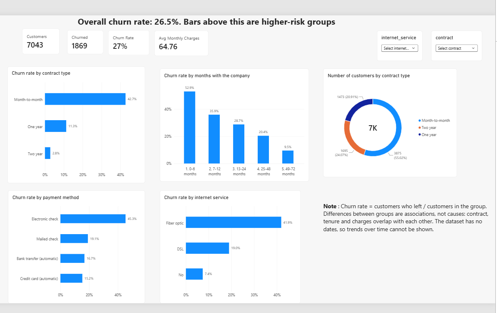
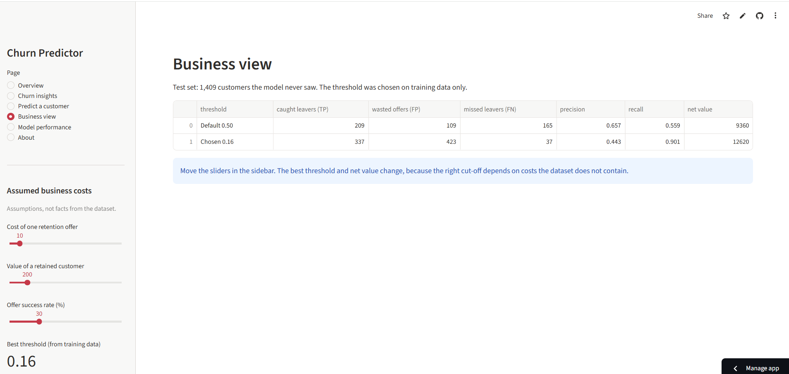
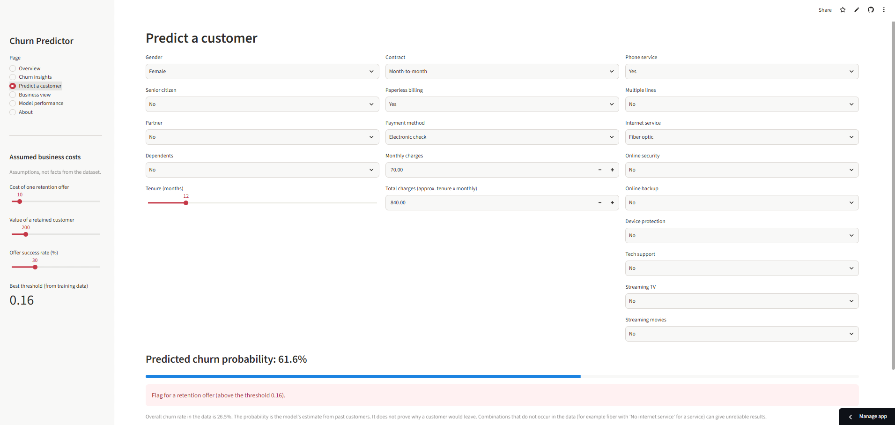

# Telco Customer Churn: Analysis, Prediction and Cost-Based Threshold

End-to-end classification project on the IBM Telco Customer Churn dataset (7,043 customers):
cleaning, EDA, model comparison with cross-validation, a cost-based decision threshold,
model explanation (coefficients and SHAP), a one-page Power BI dashboard, automated tests
and a deployed multi-page Streamlit app.

## Live app

https://sanikadighe011-churn-prediction-appapp-diszbh.streamlit.app/


(Free hosting: it may take a minute to wake up if idle.)

## Key results

- 26.5% of customers churned (1,869 of 7,043).
- Strongest patterns in the data: month-to-month contract (42.7% churn vs 2.8% on a two-year
  contract), short tenure (52.9% in months 0-6 vs 9.5% after 49 months), fiber optic internet
  (41.9%) and electronic check payment (45.3%).
- "Always predict stay" is 73.5% accurate but catches no leavers (recall 0), so accuracy alone
  is misleading here.
- Five models tied on ROC-AUC (about 0.845 in 5-fold cross-validation). The random forests
  overfit (train AUC 0.93). Logistic Regression was chosen: simple, explainable, no overfitting.
- Final model, scored once on a held-out test set: ROC-AUC 0.842.
- Threshold 0.16 (chosen on training data only, from assumed costs) catches 337 of 374 leavers
  on the test set (recall 0.90, precision 0.44) versus 209 at the default 0.50.

## Assumptions (not from the dataset)

The dataset has no costs. The threshold uses assumed values: a retention offer costs 10, a
retained customer is worth 200, and an offer succeeds 30% of the time. Under these numbers,
net value on the test set was 12,620 at threshold 0.16 versus 9,360 at 0.50. Change the
assumptions in the app sidebar and the best threshold moves.

## Limitations

- No dates in the data, so we cannot check how the model ages over time.
- The cost assumptions drive the threshold and the net-value figures.
- Contract, tenure and charges overlap, so single coefficients should not be over-read.
- Results show associations, not causes.
- One split of one dataset; precision at threshold 0.16 is only 0.44.

## Project structure

- src/ : cleaning, EDA, models, threshold, explanation scripts
- tests/ : 8 automated checks (python -m pytest -v)
- app/ : Streamlit app and score files
- models/ : saved model (load only files you created yourself)
- reports/figures/ : EDA and explanation charts
- docs/ : dashboard and app screenshots

## Run it

```
python -m venv .venv
.venv\Scripts\activate
pip install -r requirements.txt
# download Telco-Customer-Churn.csv from Kaggle into data/raw/
python src/clean_data.py
python src/compare_models.py
python src/threshold.py
python src/make_app_assets.py
python -m pytest -v
streamlit run app/app.py
```

## Screenshots







## Data source and licence

IBM Telco Customer Churn dataset (Kaggle), licence CC BY-SA 4.0:
https://creativecommons.org/licenses/by-sa/4.0/

The raw data is not included in this repository. Derived files (model scores) are shared
under the same licence (attribution, share-alike). Educational and portfolio use.
